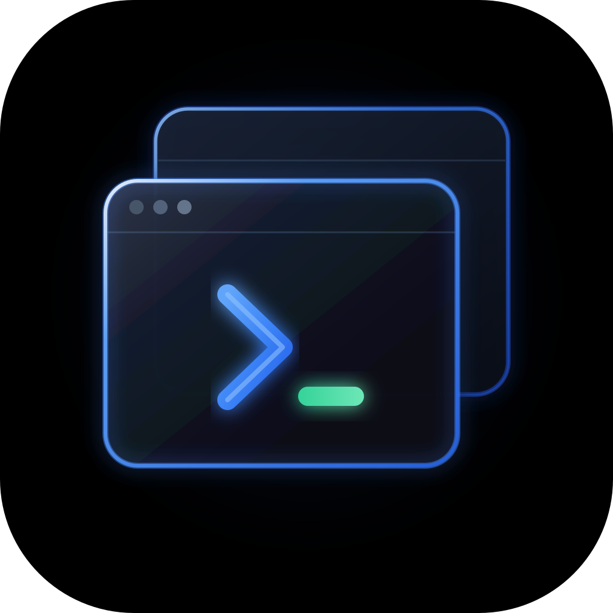

<div align="center">



# HengeLinux

**Run full-system ARM64 (`aarch64`) Linux virtual machines natively on non-jailbroken iPhone & iPad (iOS 18 – iOS 27+)**
*Direct ARM64-to-ARM64 JIT · Hardware-Accelerated VirGL 3D Metal (ANGLE) · Zero QEMU TCG · No Jailbreak Required*

[](https://github.com/venim1103/henge-linux/actions/workflows/ci.yml)
[](https://github.com/venim1103/henge-linux/releases)
[](https://github.com/venim1103/henge-linux/releases/tag/latest-ipa)
[-222327)](docs/SETUP.md)
[](LICENSE)

[**Download v0.3.0 Release**](https://github.com/venim1103/henge-linux/releases) · [**Nightly IPA (`latest-ipa`)**](https://github.com/venim1103/henge-linux/releases/tag/latest-ipa) · [**Setup Guide (`docs/SETUP.md`)**](docs/SETUP.md) · [**Architecture (`PLAN.md`)**](PLAN.md) · [**Research (`docs/RESEARCH.md`)**](docs/RESEARCH.md)

</div>

---

**HengeLinux** (`henge-linux`) is an open-source **iOS Linux virtual machine app** that boots unmodified **ARM64 Linux kernels (`EL1`)** on stock, non-jailbroken iPhones and iPads without `Hypervisor.framework` or QEMU TCG. Powered by the direct ARM64-to-ARM64 dynamic binary translation (DBT) engine and Stage-1 software MMU of [`ammaarreshi/WindowsiOS`](https://github.com/ammaarreshi/WindowsiOS) and [`Leviidev/Henge`](https://github.com/Leviidev/Henge) (`HengeVM`), HengeLinux runs **Arch Linux, Debian 13, Ubuntu 24.04/26.04 LTS, Fedora, Alpine Linux, openSUSE, Void Linux, and standard ARM64 UEFI Live/Netinstall ISOs** with **VirGL 3D Metal graphics**, **USB-C / HDMI external display output**, **native hardware keyboard/mouse**, and **in-app distro downloads** — sideloadable with **SideStore** or **AltStore** and **StikDebug** JIT.

---

## What's New in `v0.3.0`

- **Hardware-Accelerated VirGL 3D on Apple Silicon Metal:** Dedicated asynchronous `virgl_thread` running statically linked `libvirglrenderer 1.2.0` + `libepoxy 1.5.10` + Metal-only Google **ANGLE** (`OpenGL ES 3.0`), presenting zero-copy double-buffered `IOSurfaceRef` + `MTLSharedEvent` frames directly to `CAMetalLayer`, complete with a `64 MiB` persistent LRU Metal shader cache, ES 3.0 sampler wrap-mode sanitization, Jetsam VRAM budgets, thermal step-down pacing, and a 5-frame auto-recovery crash sentinel.
- **Enhanced 2D VirtIO-GPU KMS:** Native alpha-blended Metal hardware cursor (`cursorq`), `TRANSFER_TO_HOST_2D` dirty-rect partial uploads, 60 Hz frame-hash bypass, dynamic VESA EDID 1.4 (`30 / 60 / 120 Hz` ProMotion), and dual-scanout (`num_scanouts = 2`) support.
- **Redesigned 4-Tab iOS Launcher & Overflow-Safe Session Bar:** Clean separation across **Machines**, **Hardware**, **Images & Disks**, and **Information** tabs with unified semantic status colors, press-and-hold APFS VM cloning, an auto-detected **Custom** CPU/RAM profile, inline Graphics & Display controls, a live **Jetsam Memory Breakdown Bar**, an opt-in **Live Performance HUD Pill** (FPS / backend / VRAM / thermal state), and a native dark-grey iOS app icon.
- **Wayland GLES2 & X11 Linux Desktops:** One-command `sudo henge-install-desktop [--wayland|--x11]` supporting `labwc` + LXQt Wayland (`WLR_RENDERER=gles2`) or Openbox/Xorg + SDDM with automatic display-adapter switching (`henge-xorg-autodetect`).

---

## Highlights & Capabilities

| Category | Capabilities |
| :--- | :--- |
| **CPU & Memory Engine** | Direct **ARM64-to-ARM64 DBT JIT** (hot/cold block splitting, inline ARMv8.1 LSE atomics, PAC stripping) and dual-mode **4 KiB / 16 KiB Stage-1 software MMU** (`HV_TLB_PAGE_BITS=12\|14`). |
| **iOS 18 – 27+ JIT & Jetsam** | Automatic **Classic Dual-Map JIT** (iOS 18) and **TXM Broker JIT** (iOS 26/27+, compatible with stock StikDebug `universal.js` & `henge-jit.js`), one-tap `stikdebug://enable-jit`, LiveContainer detection, and live `os_proc_available_memory()` Jetsam budgeting. |
| **Two-Tier Metal GPU** | Choose per VM between **3D VirtIO-GPU VirGL (ANGLE Metal)**, **2D VirtIO-GPU KMS (EDID + Metal)**, or **2D UEFI GOP** with configurable VRAM ceilings (`Auto / 256 / 512 / 1,024 MiB`), `30 / 60 / 120 Hz` refresh, and Metal shader cache management. |
| **Multi-VM & Storage** | Isolated `Documents/Machines/<ID>/vm.json` VMs, shared `Documents/Firmware/`, in-app ARM64 Distro & Firmware Downloader, on-device **QCOW2 v2/v3** (`zlib` + `libzstd`) unpacking, offline FAT16 **Cloud-Init (`CIDATA`)** seeder, APFS sparse expansion up to `128 GiB` (`henge-grow-root`), APFS Copy-on-Write cloning, and `F_PUNCHHOLE` compaction. |
| **Virtual Hardware** | Standard **EDK2 UEFI + ACPI 6.3 + PCIe GPEX**: NVMe 1.4, `virtio-gpu` (`0x1af4:0x1050`), `virtio-input` (keyboard + absolute tablet), read-only `virtio-blk` (`512B` `CIDATA` & `2048B` El Torito ISOs), `virtio-net` (`libslirp` NAT), toggleable USB 3.0 `xhci`, and Intel ICH6 HD Audio (`CoreAudio` + `AVAudioSession`). |
| **Display, Terminal & Input** | Native **USB-C / HDMI / AirPlay External Display** scene (up to `4K UHD` + dual-scanout), drifting `#000000` **OLED Burn-In Screen Saver**, native CoreGraphics **VT100 / xterm-256color `ttyAMA0` terminal**, `GCKeyboard` + `GCMouse` hardware HID, 6×3 Split Deck trackpad, and offline **Safari OAuth / WebDAV** guest agent (`10.0.2.4/.henge/`). |

---

## Supported ARM64 Linux Distributions

| Track | Distributions | How to Get Started |
| :--- | :--- | :--- |
| **In-App Distro Gallery (Fastest)** | **Arch Linux**, **Debian 13**, **Ubuntu 24.04 / 26.04 LTS**, **Fedora 43**, **Alpine 3.23**, **openSUSE** | Open **Machines → Download Distros & Firmware** to stream EDK2 UEFI + your distro directly on-device with automatic `CIDATA` provisioning. |
| **Official Cloud Images (`.qcow2` / `.img`)** | Debian, Ubuntu, Fedora, Alpine, openSUSE, or custom URLs | Create a VM in **Machines → New ARM64 Linux VM**, import via **Images & Disks → Import Disk, ISO, or Firmware**, and tap **Generate Cloud-Init CIDATA Seed**. |
| **ARM64 Live / Netinstall ISOs** | **NixOS**, **Gentoo**, **Kali**, **Rocky / AlmaLinux**, **Void**, **Archboot** | Create a **Blank Disk + ARM64 Live ISO** VM, import any ARM64 `.iso`, install onto `/dev/nvme0n1`, and tap **Eject** on Secondary Media. |

---

## Quick Start (4 Steps — No Mac Required)

See [`docs/SETUP.md`](docs/SETUP.md) for the complete guide, desktop instructions, and troubleshooting.

1. **Sideload `HengeLinux-unsigned.ipa`:**
   - Download `HengeLinux-unsigned.ipa` from [Releases](https://github.com/venim1103/henge-linux/releases) (recommended) or [Nightly (`latest-ipa`)](https://github.com/venim1103/henge-linux/releases/tag/latest-ipa), then sign and install via **SideStore** or **AltStore** on iOS `18.0` – `27+`.
2. **Download UEFI Firmware & a Linux Distro:**
   - Open the **Machines** tab → tap **Download Distros & Firmware** → download **UEFI Firmware** once (`code.fd` + `vars.fd`), then download **Arch Linux** or any supported ARM64 cloud distro (or import local `.hvsparse` / `.qcow2` / `.img` / `.iso` files in **Images & Disks**).
3. **Enable JIT with StikDebug + LocalDevVPN:**
   - Turn on **LocalDevVPN** and tap **Enable JIT via StikDebug** in the **Machines** tab.
   - **iOS 18:** Activates `Classic Dual-Map` JIT directly (no script needed).
   - **iOS 26/27+ (TXM):** Works out of the box with stock `universal.js`, or assign [`ios/Resources/henge-jit.js`](https://raw.githubusercontent.com/venim1103/henge-linux/main/ios/Resources/henge-jit.js) via **Long-Press `HengeLinux` → Assign Script**.
4. **Configure Hardware & Boot:**
   - Open the **Hardware** tab to set **RAM / vCPUs** (with live Jetsam breakdown) and pick **3D VirtIO-GPU VirGL (ANGLE Metal)**, **2D VirtIO-GPU KMS**, or **2D UEFI GOP**.
   - Return to **Machines** and tap **Boot**. Install optional offline guest tools and a graphical desktop anytime inside Linux:
     ```sh
     curl -fsSL http://10.0.2.4/.henge/guest-tools/install.sh | sudo sh
     sudo henge-install-desktop --wayland   # or --x11 for Xorg + LXQt
     ```

---

## Target Devices & Recommended Memory

| Device Class | Example Hardware | Default Preset | Notes |
| :--- | :--- | :--- | :--- |
| **iPhone (4–6 GB RAM)** | iPhone 13 / 14 / 15 (`iOS 18+`) | **1,024 MiB (`1.0 GiB`) · 2 vCPU** *(192–256 MiB JIT)* | Best with **2D VirtIO-GPU KMS** or **2D GOP** + `ttyAMA0` terminal |
| **iPhone Pro (8 GB RAM)** | iPhone 15 Pro / 16 Pro (`A18 Pro`) | **1,536 MiB (`1.5 GiB`) · 4 vCPU** *(≤ 1,792 MiB standard)* | Safe headroom for **VirGL 3D Metal** LXQt/Wayland desktop on standard SideStore ledger |
| **12 GB+ Pro / Foldable iPhone** | iPhone 17 Pro / iPhone Duo (`UIHingeInteraction`) | **3,072 MiB (`3.0 GiB`) · 4 vCPU** *(entitled)* / **1,536 MiB** *(standard)* | Heavy multi-process desktops, clamshell deck, and dual-scanout |
| **M-Series iPad Pro (8–16 GB)** | iPad Pro M1–M4 (`iPadOS 18–27+`) | **4,096 MiB (`4.0 GiB`) · 6 vCPU** *(entitled)* | USB-C `4K UHD` external display, VirGL 3D, hardware keyboard & mouse |

---

## Architecture & Why HengeLinux Is Fast

Stock iOS `16.4+` restricts `com.apple.developer.kernel.hypervisor` on non-jailbroken devices, forcing App Store emulators onto QEMU's threaded interpreter (`TCI`) while iOS `26+` Trusted Execution Monitor (`TXM`) blocks arbitrary `PROT_EXEC` pages.

HengeLinux eliminates cross-architecture IR overhead completely:

- **Direct ARM64-to-ARM64 Block Translation (`core/translate.c`):** Translates unprivileged guest `aarch64` code straight to host Apple Silicon instructions with inline LSE atomics and scratch register allocation.
- **Dual-Mode Stage-1 Software MMU (`core/mmu.c`):** Emulates VMSAv8-64 `EL1&0` translation across `4 KiB`, `16 KiB`, and `64 KiB` guest granules (`HV_TLB_PAGE_BITS=12|14`).
- **Async Zero-Copy VirGL 3D Pipeline (`host/henge_virgl_worker.c`, `host/henge_gpu_surface.c`):** Offloads VirtIO-GPU 3D commands to a dedicated `8 MiB`-stack `virgl_thread` (`libvirglrenderer` → `libepoxy` → Metal-only `ANGLE`) and presents `IOSurfaceRef` swapchains with `MTLSharedEvent` synchronization directly onto `CAMetalLayer`.
- **Zero-Driver-Injection Virtual Motherboard (`devices/` & `host/`):** Boots stock Linux kernels using mainline inbox drivers (EDK2 UEFI, ACPI 6.3, PCIe GPEX, NVMe, VirtIO-GPU/Input/Blk/Net, ICH6 HDA).

---

## Build Environments & Documentation

| Task | Apple Silicon Mac | Intel (`x86_64`) Mac | Linux PC |
| :--- | :--- | :--- | :--- |
| **Build iOS App (`.ipa`)** | **Yes** (`Xcode 26 / 27`) | **Yes** (up to Xcode 26) | **Via GitHub Actions** (`macos-latest` CI) |
| **Run Core Unit Tests (`make test-core`)** | **Yes** | **Yes** | **Yes** (4 KiB & 16 KiB TLB + QCOW2/VirGL) |
| **Build `hvsparse` & Guest Images** | **Yes** (`provision_archlinux_arm64.sh`) | **Yes** | **Yes** (`make prebuilt-guest-image`) |

### Documentation Index
- **[`docs/SETUP.md`](docs/SETUP.md)** — Full iOS 18–27+ sideloading, StikDebug JIT, VirGL 3D, desktop setup, and troubleshooting guide.
- **[`PLAN.md`](PLAN.md)** — Engineering architecture, module map, platform invariants, and Phase 1–7 milestones.
- **[`HANDOVER.md`](HANDOVER.md)** — Detailed commit history, file inventory, and CI build/debugging reference.
- **[`docs/RESEARCH.md`](docs/RESEARCH.md)** — Technical comparison of `WindowsiOS`/`HengeVM` and Linux-on-iOS virtualization approaches.
- **[`docs/HengeLinux v3.0 GPU Architecture.pdf`](docs/HengeLinux%20v3.0%20GPU%20Architecture.pdf)** — Deep-dive blueprint for the `v0.3.0` Two-Tier Metal GPU & VirGL stack.
- **[`THIRD_PARTY_NOTICES.md`](THIRD_PARTY_NOTICES.md)** — GPLv3 §5a / §6(d) attribution and pinned source provenance.

---

## Roadmap

1. **Phase 1–4 — Architecture, Core Engine, Arch Bridge & TXM JIT Substrate:** Technical specification, `HengeVM`/`WindowsiOS` host substrate, `"HVSPARSE"` disk tools, dual-stack Safari OAuth/WebDAV bridge, embedded `HengeLinuxJITExtension`, and VirtIO-GPU state machine.
2. **Phase 5 (`v0.1.0`) — Live Arch Linux & LXQt Desktop on iOS:** Upstream patcher (`scripts/apply_upstream_patches.py`), cached iOS static deps, editable Guest RAM, native `/dev/uinput` HID bridge, and automated Arch Linux ARM64 guest image CI.
3. **Phase 6 (`v0.2.0` – `v0.2.5`) — Multi-Distro ARM64 Linux & iOS 18–27+ Generalization:** iOS `18.0` floor (`CLASSIC`/`TXM_BROKER` JIT), Multi-VM `VMStore`, in-app Distro & Firmware Gallery, streaming QCOW2 (`zlib`+`zstd`), `CIDATA` seeder, APFS sparse disk expansion, `virtio-input`/`virtio-blk`/`virtio-gpu` 2D KMS, native VT100 `ttyAMA0` terminal, USB-C/HDMI External Display + OLED Screen Saver, `GCKeyboard`/`GCMouse`, `AVAudioSession`, and static `musl` guest agent.
4. **Phase 7 (`v0.3.0`) — Two-Tier Metal GPU Acceleration & 4-Tab iOS UI Overhaul:** Enhanced 2D KMS (native Metal hardware cursor + dirty-rect uploads), async zero-copy **VirGL 3D via ANGLE Metal** (`libvirglrenderer 1.2.0` + `libepoxy 1.5.10` + `ANGLE chromium/7578`, `IOSurfaceRef` + `MTLSharedEvent` swapchains, `64 MiB` shader cache, ES 3.0 wrap-mode sanitization, Jetsam VRAM budgets, thermal/ProMotion pacing), Wayland GLES2 + X11 desktop installer, **4-tab SwiftUI launcher** (`Machines`, `Hardware`, `Images & Disks`, `Information`), overflow-safe session top bar, unified semantic status indicators, Live Performance HUD, and dark-grey native app icon.

---

## License

Licensed under the **GNU General Public License v3.0 or later (`GPL-3.0-or-later`)** — see [`LICENSE`](LICENSE) and [`THIRD_PARTY_NOTICES.md`](THIRD_PARTY_NOTICES.md).

- Upstream `WindowsiOS` and `HengeVM` components (`GPL-2.0-or-later`) upgrade cleanly into `GPL-3.0-or-later`.
- `StikJIT` (`MPL-2.0`), `idevice` (`MIT`), `ANGLE` (`BSD-3-Clause`), `libepoxy` (`MIT`), `libvirglrenderer` (`MIT`), and `zstd` (`BSD-3-Clause / GPL-2.0`) are license-compatible under `GPL-3.0-or-later`.
